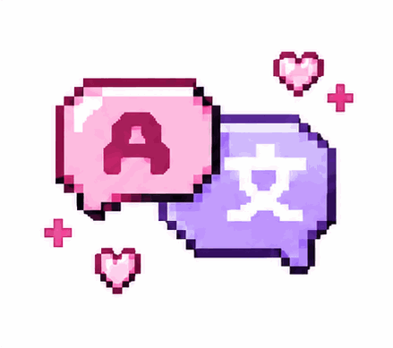

<h2>
  
  About Me
</h2>

 
 
 
 

--- 

<h2>
  
  Languages
</h2>

 

--- 

<h2>
  
  Tools
</h2>

---

<h2>
  
  GitHub Contributions
</h2>

---

<h2>
  
  Let's Connect!
</h2>

  

*୨୧ Here come the sun, and I say, it's all right!*

